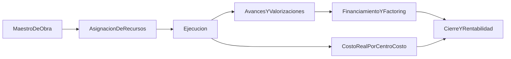
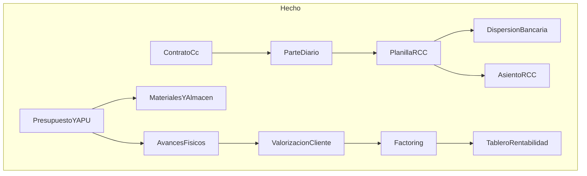
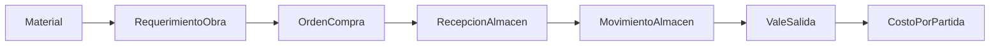
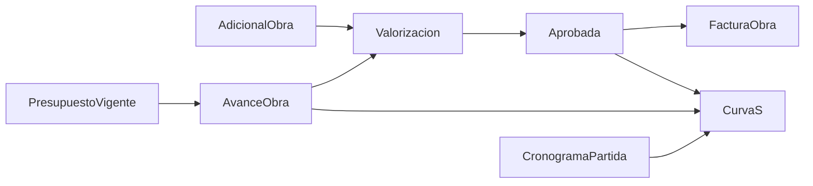
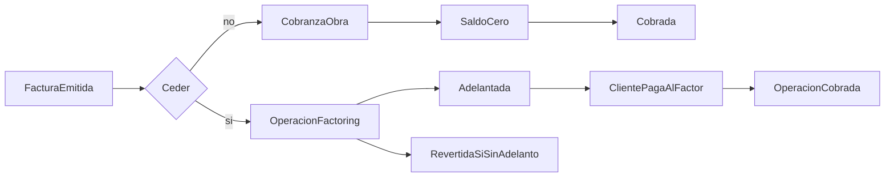
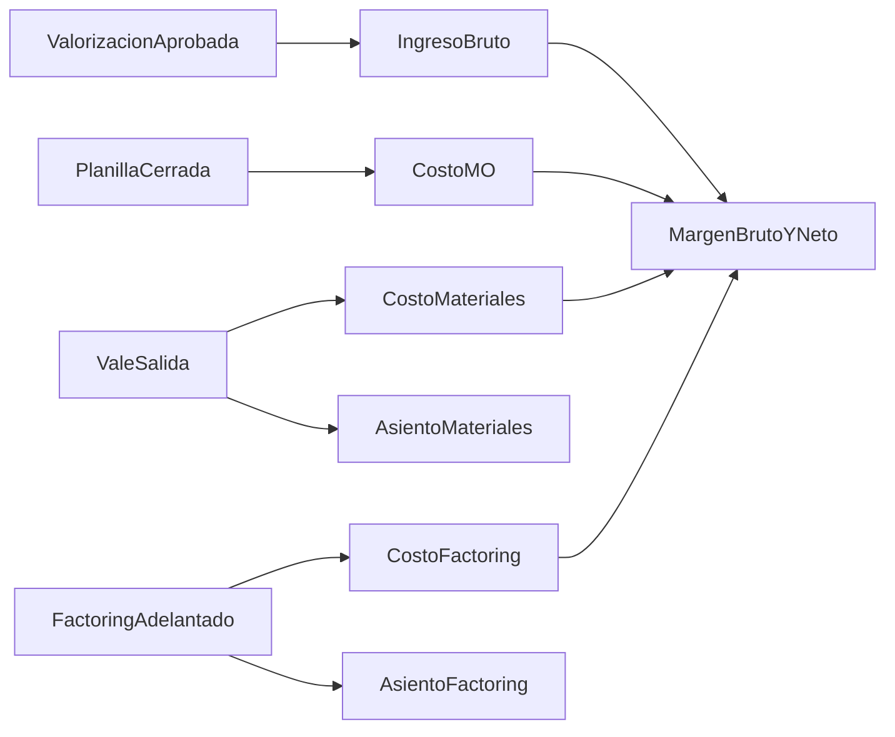
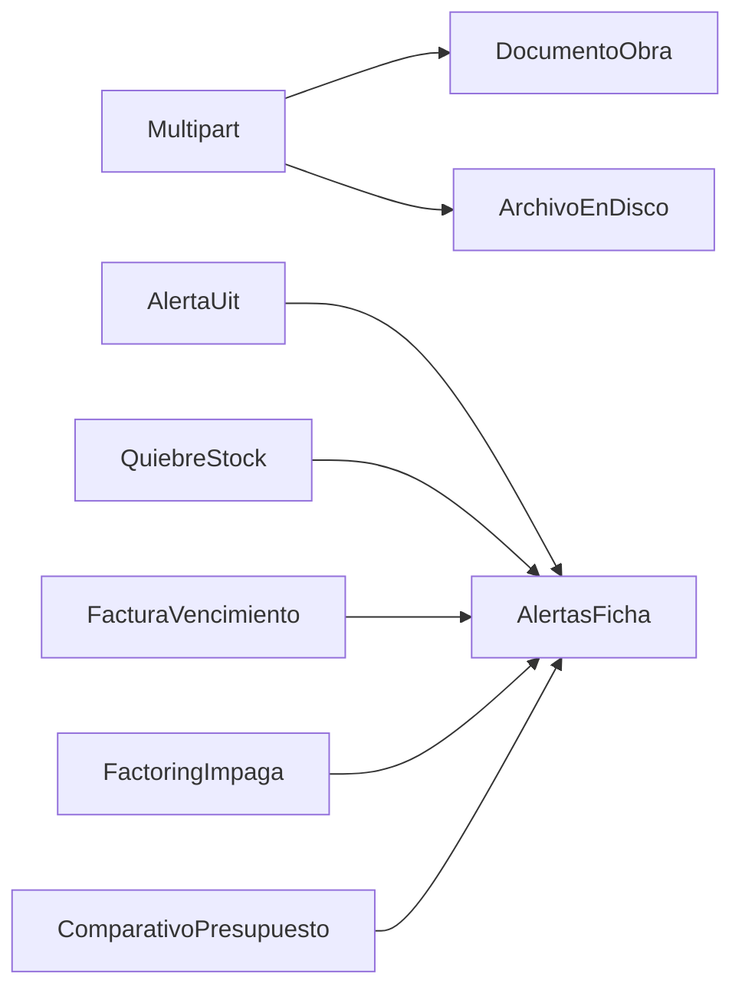

# Seguimiento del módulo Proyectos

Documento vivo de seguimiento para la gestión de obras en el ERP Convecsa. Sirve como checklist de implementación: se marcan objetivos a medida que se cierran. Lo marcado como **Hecho** cita archivos reales; lo **Pendiente** propone nombres de entidades, endpoints y páginas Vue como guía de implementación, no como contrato cerrado.

Última revisión: 2026-11-07.

## Leyenda

| Casilla | Significado |
| --- | --- |
| `[x]` | Hecho y verificable en el código actual |
| `[ ]` | Pendiente |
| Parcial | Hay un subconjunto hecho; el resto queda abierto en la misma sección |

Estados de sección usados en el resumen: **Hecho**, **Parcial**, **Pendiente**.

Convención de cada sección:

1. Objetivos (checkboxes).
2. Cómo funciona, a grandes rasgos.
3. Desglose técnico (entidad, endpoint, página Vue). En lo pendiente, los nombres son orientativos.

---

## 1. Resumen y alcance

El módulo Proyectos es el contenedor de cada obra de la constructora. Una obra nace en el maestro, recibe personal y recursos, se ejecuta (tareo, materiales, equipos), se valoriza al cliente y se financia (incluido factoring). El costo real se agrupa por centro de costo y alimenta rentabilidad y asiento contable.

Hoy el ERP cubre el **ciclo de mano de obra RCC** (alta de obra, contrato de obrero, parte diario, planilla, boletas, dispersión bancaria y asiento), el **presupuesto por partidas/APU**, el **ciclo de almacén de obra** (catálogo, requerimiento, OC, recepción, kardex y vale de salida), el **ciclo de avance/valorización** (metrados, cronograma, valorización mensual, adicionales, curva S y factura interna), el **ciclo de financiamiento** (cobranzas, retenciones, factoring y flujo de caja ejecutado), el **tablero de rentabilidad** (P&amp;L de obra por devengo y asientos de materiales/factoring) y **documentos + alertas** en la ficha. Quedan permisos por obra, auditoría y bitácora.

Subflujo de ejecución:

### Estado global por subsección

| # | Subsección | Estado |
| --- | --- | --- |
| 2 | Maestro de Obras | Hecho |
| 3 | Asignación de recursos | Parcial |
| 4 | Parte diario y mano de obra | Hecho |
| 5 | Presupuesto y costeo meta | Parcial |
| 6 | Materiales y almacén | Hecho |
| 7 | Avances y valorizaciones | Hecho |
| 8 | Financiamiento de obra (incluye factoring) | Hecho |
| 9 | Integración contable y rentabilidad | Hecho |
| 10 | Transversales | Parcial |

Navegación actual del módulo: grupo **Proyectos** en [`frontend/src/layouts/nav.ts`](../../frontend/src/layouts/nav.ts) con un único hijo **Obras** (`/proyectos`). La ficha se abre desde la fila de cada obra; Tareo, Planilla, Presupuesto, Almacén, Avances, Financiamiento, Rentabilidad y Documentos viven como pestañas de esa ficha. Las alertas operativas se muestran en el hub.

Rutas Vue:

- `/proyectos` → [`ProyectosPage.vue`](../../frontend/src/pages/proyectos/ProyectosPage.vue)
- `/proyectos/:id` → [`ProyectoFichaPage.vue`](../../frontend/src/pages/proyectos/ProyectoFichaPage.vue) (tab Resumen)
- `/proyectos/:id/tareo` → misma ficha, tab Tareo ([`ProyectoTareoPage.vue`](../../frontend/src/pages/proyectos/ProyectoTareoPage.vue))
- `/proyectos/:id/planilla` → misma ficha, tab Planilla ([`ProyectoPlanillaPage.vue`](../../frontend/src/pages/proyectos/ProyectoPlanillaPage.vue))
- `/proyectos/:id/presupuesto` → misma ficha, tab Presupuesto ([`ProyectoPresupuestoPage.vue`](../../frontend/src/pages/proyectos/ProyectoPresupuestoPage.vue))
- `/proyectos/:id/almacen` → misma ficha, tab Almacén ([`ProyectoAlmacenPage.vue`](../../frontend/src/pages/proyectos/ProyectoAlmacenPage.vue))
- `/proyectos/:id/avances` → misma ficha, tab Avances ([`ProyectoAvancesPage.vue`](../../frontend/src/pages/proyectos/ProyectoAvancesPage.vue))
- `/proyectos/:id/financiamiento` → misma ficha, tab Financiamiento ([`ProyectoFinanciamientoPage.vue`](../../frontend/src/pages/proyectos/ProyectoFinanciamientoPage.vue))
- `/proyectos/:id/rentabilidad` → misma ficha, tab Rentabilidad ([`ProyectoRentabilidadPage.vue`](../../frontend/src/pages/proyectos/ProyectoRentabilidadPage.vue))
- `/proyectos/:id/documentos` → misma ficha, tab Documentos ([`ProyectoDocumentosPage.vue`](../../frontend/src/pages/proyectos/ProyectoDocumentosPage.vue))

API base: [`ConstruccionController`](../../backend/erp/src/main/java/com/convecsa/erp/construccion/controller/ConstruccionController.java) en `/api/proyectos`.

---

## 2. Maestro de Obras — Hecho

Catálogo de obras de construcción civil. Cada obra es un `Proyecto` con código único, centro de costo, valor contractual y parámetros SCTR.

### Objetivos

- [x] Alta de obra con código único, nombre, ubicación, centro de costo y valor de obra
- [x] Nivel de riesgo (BAJO / MEDIO / ALTO) y tasas SCTR salud / pensión
- [x] Alerta informativa cuando el valor de obra supera 50 UIT (no bloquea tareo ni liquidación)
- [x] Listado de obras activas con columnas de riesgo, SCTR y estado
- [x] Consulta de catálogos (categorías obreras, especialidades BAE, UIT del año)
- [x] Edición posterior de una obra ya creada (`PUT /api/proyectos/{id}`)
- [x] Baja lógica / reactivación desde la ficha (campo `activo` + `estadoObra`)
- [x] Datos de cliente (`clienteRazon`, `clienteRuc`), vigencia (`fechaInicio` / `fechaFin`) y estado de obra (`EN_EJECUCION` | `PARALIZADA` | `LIQUIDADA`)

### Cómo funciona

El usuario entra a **Obras**, ve la tabla y abre el modal **Nueva obra**. Completa código, nombre, ubicación, centro de costo, valor, nivel de riesgo y tasas SCTR. El alta nace en `EN_EJECUCION`. El backend valida código duplicado, normaliza el código a mayúsculas y calcula `alertaUit` contra la UIT vigente. Esa alerta se muestra en el listado y en la ficha, pero no impide operar.

**Abrir** entra a la ficha: en Resumen se editan los mismos campos más cliente, RUC (11 dígitos si no va vacío), fechas de vigencia (`fecha_fin >= fecha_inicio`), estado de obra y retención porcentual (0–100, se aplica a cada valorización). `activo` (baja lógica) convive con `estadoObra`. El código único se valida ignorando el propio id.

El centro de costo de la obra es el fallback cuando el obrero no tiene centro propio en su contrato RCC.

### Desglose técnico

| Capa | Ubicación |
| --- | --- |
| Entidad | [`Proyecto.java`](../../backend/erp/src/main/java/com/convecsa/erp/construccion/entity/Proyecto.java) |
| DTO | [`ProyectoDTO.java`](../../backend/erp/src/main/java/com/convecsa/erp/construccion/dto/ProyectoDTO.java), [`ProyectoRequest.java`](../../backend/erp/src/main/java/com/convecsa/erp/construccion/dto/ProyectoRequest.java) |
| Dominio | [`NivelRiesgoObra.java`](../../backend/erp/src/main/java/com/convecsa/erp/construccion/domain/NivelRiesgoObra.java), [`EstadoObra.java`](../../backend/erp/src/main/java/com/convecsa/erp/construccion/domain/EstadoObra.java) |
| Alerta UIT | [`UitObraAlerta.java`](../../backend/erp/src/main/java/com/convecsa/erp/construccion/support/UitObraAlerta.java) |
| Endpoints | `GET /api/proyectos`, `GET /api/proyectos?activo=`, `POST /api/proyectos`, `GET /api/proyectos/{id}`, `PUT /api/proyectos/{id}`, `GET /api/proyectos/catalogos` |
| UI | [`ProyectosPage.vue`](../../frontend/src/pages/proyectos/ProyectosPage.vue), tab Resumen de [`ProyectoFichaPage.vue`](../../frontend/src/pages/proyectos/ProyectoFichaPage.vue) |
| Migraciones | `V42` (tabla `proyecto`), `V44` (`valor_obra`), `V45` (`nivel_riesgo`, tasas SCTR), `V47` (cliente, vigencia, `estado_obra`), `V50` (`porcentaje_retencion`) |

---

## 3. Asignación de recursos — Parcial

Quién y qué se asigna a la obra: personal, cuadrillas, maquinaria, responsables y subcontratistas.

### Objetivos

Personal RCC (hecho):

- [x] Asignar obrero a una obra desde el alta de contrato RCC (`ContratoCc.proyecto`)
- [x] Centro de costo por obrero, con fallback al de la obra
- [x] Categoría (OPERARIO / OFICIAL / PEON), especialidad BAE, afiliación sindical, hijos escolaridad
- [x] Listar personal activo de la obra (`GET /{id}/personal`) con fechas de ingreso y cese
- [x] El tareo y la liquidación usan solo personal con contrato activo en esa obra

Resto de recursos (pendiente):

- [ ] Cuadrillas o frentes de trabajo (estructura, acabados, instalaciones) y asignación de obreros a cuadrilla
- [x] Responsables de obra: residente, maestro de obra, supervisor SSOMA (un responsable por rol, persona del padrón)
- [ ] Asignación de maquinaria y equipos (propios o alquilados) con fecha de ingreso/salida y tarifa/hora o tarifa/día
- [ ] Subcontratistas por especialidad, con monto contratado y avance
- [ ] Vista de “equipo de obra” unificada (personal + equipos + subcontratos)

### Cómo funciona (hoy)

El vínculo obra–obrero no se da en la pantalla de Obras: se da en **Gestión Humana → Contratos**. Al registrar un contrato de construcción civil se elige el `proyecto` y, opcionalmente, un `centroCosto`. Ese contrato alimenta `GET /api/proyectos/{id}/personal`, el parte diario y la planilla. Si el obrero cesa (`contrato.fechaFin`), el parte diario deshabilita los días posteriores y resalta la fila en el mes del cese.

Los responsables (residente, maestro de obra, supervisor SSOMA) se eligen en la ficha, tab Resumen, con Combobox sobre `listarPersonas`. `PUT /api/proyectos/{id}/responsables` reemplaza el set (0 a 3 filas, unique por rol). No es un maestro de clientes ni un módulo de equipos: el cliente sigue siendo campos en la obra.

### Desglose técnico (hecho)

| Capa | Ubicación |
| --- | --- |
| Entidad | [`ContratoCc.java`](../../backend/erp/src/main/java/com/convecsa/erp/construccion/entity/ContratoCc.java) |
| DTO | [`PersonalObraDTO.java`](../../backend/erp/src/main/java/com/convecsa/erp/construccion/dto/PersonalObraDTO.java) |
| Endpoint | `GET /api/proyectos/{id}/personal` |
| Alta | [`ContratoRegistroModal.vue`](../../frontend/src/components/gestion-humana/ContratoRegistroModal.vue) (campo proyecto + centro de costo) |
| Consumo | tareo y planilla |

### Desglose técnico (responsables — hecho)

| Capa | Ubicación |
| --- | --- |
| Entidad | [`ProyectoResponsable.java`](../../backend/erp/src/main/java/com/convecsa/erp/construccion/entity/ProyectoResponsable.java) |
| Dominio | [`RolResponsableObra.java`](../../backend/erp/src/main/java/com/convecsa/erp/construccion/domain/RolResponsableObra.java) |
| DTO | [`ResponsableObraDTO.java`](../../backend/erp/src/main/java/com/convecsa/erp/construccion/dto/ResponsableObraDTO.java), [`ProyectoResponsableRequest.java`](../../backend/erp/src/main/java/com/convecsa/erp/construccion/dto/ProyectoResponsableRequest.java) |
| Endpoints | `GET /api/proyectos/{id}/responsables`, `PUT /api/proyectos/{id}/responsables` |
| UI | Combobox por rol en [`ProyectoFichaPage.vue`](../../frontend/src/pages/proyectos/ProyectoFichaPage.vue) |
| Migración | `V47` (tabla `proyecto_responsable`, unique `(proyecto_id, rol)`) |

### Desglose técnico (propuesto)

| Recurso | Entidad | Endpoints | UI |
| --- | --- | --- | --- |
| Cuadrilla | `CuadrillaObra`, `CuadrillaMiembro` | `/api/proyectos/{id}/cuadrillas` | pestaña en ficha de obra |
| Equipos | `AsignacionEquipo` | `/api/proyectos/{id}/equipos` | `ProyectoEquiposPage.vue` |
| Subcontratos | `SubcontratoObra` | `/api/proyectos/{id}/subcontratos` | `ProyectoSubcontratosPage.vue` |

---

## 4. Parte diario y mano de obra — Hecho

Registro diario de asistencia RCC, periodos de pago y liquidación de planilla de construcción civil.

### 4.1 Parte diario (tareo)

#### Objetivos

- [x] Vista mensual 1..N días según el mes (febrero 28/29, resto 30/31)
- [x] Auto-creación de periodo `MENSUAL` al elegir mes/año
- [x] Matriz Ord / +60% / +100% por día, domingo en ámbar, cesados del mes resaltados
- [x] Columnas sticky: ítem, trabajador, F. Ingreso, F. Cese
- [x] Códigos LAB / F / DSC / FE / DM / LIC; incidencias ponen horas en cero
- [x] Atributos de jornal (BAE, movilidad, altura, altitud, cota cero, altas temperaturas, agua, aguas servidas, nocturno, pisos)
- [x] Totales por fila de horas ordinarias, HE 60 y HE 100
- [x] Dominical por semana ISO: (horas L–S) / 6
- [x] Cadencia SEMANAL / QUINCENAL / MENSUAL en backend (la UI de tareo fija MENSUAL)
- [x] Periodo cerrado = tareo de solo lectura
- [ ] Exportar parte diario a Excel / PDF
- [ ] Bloqueo por aprobación de residente (hoy solo existe BORRADOR / CERRADO ligado a liquidación)

#### Cómo funciona

En **Obras → Tareo** el usuario elige mes y año. Si no hay periodo mensual, el front lo crea (`cadencia=MENSUAL`, día 1 al último). El backend materializa un `TareoCcDia` por obrero y fecha (domingo nace en DSC; L–S nace en LAB con jornada parametrizada). El usuario edita horas y, vía el panel `⋯`, el código y los atributos. Guardar persiste el lote. El dominical no se teclea: se calcula al liquidar.

#### Desglose técnico

| Capa | Ubicación |
| --- | --- |
| Entidades | [`PeriodoCc.java`](../../backend/erp/src/main/java/com/convecsa/erp/construccion/entity/PeriodoCc.java), [`TareoCcDia.java`](../../backend/erp/src/main/java/com/convecsa/erp/construccion/entity/TareoCcDia.java) |
| Dominio | [`CadenciaPeriodoCc`](../../backend/erp/src/main/java/com/convecsa/erp/construccion/domain/CadenciaPeriodoCc.java), [`CodigoTareoCc`](../../backend/erp/src/main/java/com/convecsa/erp/construccion/domain/CodigoTareoCc.java), [`EstadoPeriodoCc`](../../backend/erp/src/main/java/com/convecsa/erp/construccion/domain/EstadoPeriodoCc.java) |
| Dominical | [`DominicalCc.java`](../../backend/erp/src/main/java/com/convecsa/erp/construccion/support/DominicalCc.java) |
| Endpoints | `GET/POST /{id}/periodos`, `GET /{id}/periodos/{periodoId}`, `POST .../cerrar`, `GET/PUT .../tareo` |
| UI | [`ProyectoTareoPage.vue`](../../frontend/src/pages/proyectos/ProyectoTareoPage.vue), [`ParteDiarioRccGrid.vue`](../../frontend/src/components/proyectos/ParteDiarioRccGrid.vue) |

### 4.2 Planilla RCC, boletas y dispersión

#### Objetivos

- [x] Liquidar el periodo a partir del tareo (no se toca `CalculoNominaService` de RGC)
- [x] Conceptos CALCULADO / MANUAL / TAREO; los MANUAL sobreviven la reliquidación (reintegro, descuento)
- [x] SCTR salud y pensión como aporte empleador según tasas de la obra (neto del obrero no cambia)
- [x] Boleta HTML y PDF individual
- [x] PDF combinado de un lote de boletas
- [x] Envío masivo por correo con auditoría (`boleta_cc_envio_correo`)
- [x] Dispersión CCI / BCP / Interbank; omite filas sin cuenta del banco pedido
- [x] Cerrar periodo solo si ya hay boletas
- [ ] Vista de conceptos de boleta imprimible alineada 1:1 con la plantilla Excel histórica (el caso OB001 está cubierto en tests)

#### Cómo funciona

Desde **Planilla** se elige el periodo, se liquida y se listan boletas (haberes, descuentos, neto). Se pueden marcar varias para PDF lote, correo o archivo de banco. Los extras MANUAL (reintegro / descuento) se cargan sobre una boleta y no se pisan al reliquidar. La dispersión respeta el layout 2026 documentado en [`docs/planilla-cc/layouts-bancos-2026.json`](../planilla-cc/layouts-bancos-2026.json).

Caso de referencia: [`docs/planilla-cc/caso-ob001.json`](../planilla-cc/caso-ob001.json). Si las tasas SCTR de la obra son 0, el neto del caso gold no cambia.

#### Desglose técnico

| Capa | Ubicación |
| --- | --- |
| Motor | [`CalculoNominaCcService.java`](../../backend/erp/src/main/java/com/convecsa/erp/construccion/support/CalculoNominaCcService.java) |
| Boleta | [`BoletaCc.java`](../../backend/erp/src/main/java/com/convecsa/erp/construccion/entity/BoletaCc.java), [`BoletaCcPlantillaService.java`](../../backend/erp/src/main/java/com/convecsa/erp/construccion/support/BoletaCcPlantillaService.java) |
| Dispersión | [`DispersionArchivoService.java`](../../backend/erp/src/main/java/com/convecsa/erp/nomina/declaracion/support/DispersionArchivoService.java) |
| Endpoints | `POST .../liquidar`, `GET .../boletas`, `GET .../boletas/{id}`, `GET .../documento`, `GET .../pdf`, `PUT .../extras`, `POST .../boletas/pdf`, `POST .../boletas/correo`, `GET .../dispersion?banco=` |
| UI | [`ProyectoPlanillaPage.vue`](../../frontend/src/pages/proyectos/ProyectoPlanillaPage.vue) |

PLAME: códigos `REINTEGRO=0121`, `DESCUENTO_MANUAL=0701`. La declaración mensual (Gestión Humana) consolida RCC + RGC; no forma parte de esta pantalla pero sí del cierre de mes de la obra.

---

## 5. Presupuesto y costeo meta — Parcial

El costo objetivo de la obra, desglosado por partidas (APU) y metrados, contra el cual se comparará el costo real.

### Objetivos

- [x] Cargar presupuesto por partidas (capítulo, partida, unidad, metrado, precio unitario, total) desde la ficha
- [ ] Importar presupuesto desde Excel
- [x] APU por partida: mano de obra, materiales, equipos, subcontratos, gastos generales
- [x] Metrado meta versus metrado ejecutado (se alimenta de la sección 7)
- [x] Costo objetivo por obra y por centro de costo (cuadrilla sigue pendiente)
- [x] Comparativo meta vs real de mano de obra RCC y de materiales (vales de salida); equipos aún sin dato
- [x] Versiones de presupuesto (inicial, actualizado, adicional)
- [x] Bloqueo de presupuesto vigente: solo se edita un borrador; vigentar pasa el anterior a histórico

### Cómo funciona (hoy)

En **Obras → Abrir → Presupuesto** se crea la versión inicial en borrador. Se cargan partidas en tabla; cada una puede llevar APU. Si hay recursos APU, el P.U. de la partida es la suma de parciales; si no, se teclea. Marcar vigente bloquea la edición. Una versión nueva (actualizado o adicional) copia la vigente. El comparativo de mano de obra usa APU `MANO_OBRA` × metrado frente a `totalHaberes + totalAportesEmpleador` de las boletas RCC. El de materiales usa APU `MATERIAL` × metrado frente al costo de los vales de salida, agrupado por centro de costo. El metrado ejecutado de cada partida se registra en la pestaña Avances (sección 7) y se compara con el metrado meta.

### Desglose técnico (hecho)

| Capa | Ubicación |
| --- | --- |
| Entidades | [`PresupuestoVersion.java`](../../backend/erp/src/main/java/com/convecsa/erp/construccion/entity/PresupuestoVersion.java), [`PartidaPresupuesto.java`](../../backend/erp/src/main/java/com/convecsa/erp/construccion/entity/PartidaPresupuesto.java), [`ApuPartida.java`](../../backend/erp/src/main/java/com/convecsa/erp/construccion/entity/ApuPartida.java) |
| Dominio | `TipoVersionPresupuesto`, `EstadoVersionPresupuesto`, `TipoRecursoApu` |
| Endpoints | `GET /api/proyectos/{id}/presupuesto`, `POST .../presupuesto/versiones`, `PUT .../versiones/{versionId}/partidas`, `POST .../vigentar`, `GET .../presupuesto/comparativo` |
| UI | tab Presupuesto de [`ProyectoFichaPage.vue`](../../frontend/src/pages/proyectos/ProyectoFichaPage.vue), [`ProyectoPresupuestoPage.vue`](../../frontend/src/pages/proyectos/ProyectoPresupuestoPage.vue) |
| Migración | `V48` |
| Relación | `PartidaPresupuesto.centroCosto` alinea con `ContratoCc.centroCosto` (fallback: centro de la obra) |

---

## 6. Materiales y almacén — Hecho

Ciclo de abastecimiento de la obra: pedido, compra, recepción, kardex y consumo por partida.

### Objetivos

- [x] Catálogo de materiales (código, unidad, familia, stock mínimo)
- [x] Requerimiento de materiales emitido por la obra, ligado a partida (cuadrilla queda fuera de fase)
- [x] Orden de compra (proveedor en columnas, precio, plazo) y su estado (borrador, emitida, recepcionada, cerrada)
- [x] Recepción en almacén de obra contra la OC, con diferencias (pendiente vs recibido); `numeroGuia` texto, sin GRE/SUNAT
- [x] Kardex por almacén de obra (entradas, salidas, ajustes) y costo promedio ponderado
- [x] Vale de salida / consumo imputado a partida y a centro de costo
- [x] Valorización de inventario al cierre de mes (snapshot; el asiento de consumo está en la sección 9)
- [x] Alerta de quiebre de stock y de materiales críticos
- [x] Devoluciones a almacén de obra (desde vale) y a proveedor. Descartado: almacén central

### Cómo funciona (hoy)

En **Obras → Abrir → Almacén** hay un catálogo empresa y un almacén por obra (se crea al primer acceso). El residente arma un requerimiento (borrador → aprobado), opcionalmente sugerido desde APU `MATERIAL` de la vigente. Compras genera la OC (proveedor razón/RUC, no maestro) y al emitir cubre el requerimiento. La recepción entra al kardex al precio de la OC y recalcula CMP. El vale de salida descuenta stock al CMP e imputa costo a la partida vigente. El comparativo de presupuesto toma el real de materiales de esos vales. El asiento de consumo se consulta en la pestaña Rentabilidad (sección 9).

### Desglose técnico (hecho)

| Capa | Ubicación |
| --- | --- |
| Entidades | [`Material.java`](../../backend/erp/src/main/java/com/convecsa/erp/construccion/entity/Material.java), [`AlmacenObra.java`](../../backend/erp/src/main/java/com/convecsa/erp/construccion/entity/AlmacenObra.java), [`RequerimientoObra.java`](../../backend/erp/src/main/java/com/convecsa/erp/construccion/entity/RequerimientoObra.java), [`OrdenCompra.java`](../../backend/erp/src/main/java/com/convecsa/erp/construccion/entity/OrdenCompra.java), [`RecepcionAlmacen.java`](../../backend/erp/src/main/java/com/convecsa/erp/construccion/entity/RecepcionAlmacen.java), [`ValeSalida.java`](../../backend/erp/src/main/java/com/convecsa/erp/construccion/entity/ValeSalida.java), [`MovimientoAlmacen.java`](../../backend/erp/src/main/java/com/convecsa/erp/construccion/entity/MovimientoAlmacen.java), [`InventarioCierre.java`](../../backend/erp/src/main/java/com/convecsa/erp/construccion/entity/InventarioCierre.java) |
| Servicio | [`AlmacenServiceImpl.java`](../../backend/erp/src/main/java/com/convecsa/erp/construccion/service/impl/AlmacenServiceImpl.java) |
| Endpoints | `GET/POST /api/proyectos/materiales`, `GET /api/proyectos/{id}/almacen`, requerimientos, compras, vales, kardex, cierre |
| UI | tab Almacén de [`ProyectoFichaPage.vue`](../../frontend/src/pages/proyectos/ProyectoFichaPage.vue), [`ProyectoAlmacenPage.vue`](../../frontend/src/pages/proyectos/ProyectoAlmacenPage.vue) |
| Migración | `V49` |
| Nota | Un almacén por obra. Proveedor = columnas en la OC. Sin cuadrillas, sin GRE electrónica. Asiento de consumo en la sección 9 |

---

## 7. Avances y valorizaciones — Hecho

Avance físico de partidas, cronograma y cobro al cliente (valorización mensual con retención, adicionales/deductivos, curva S y factura interna).

### Objetivos

- [x] Registro de avance físico por partida (metrado ejecutado del periodo y acumulado)
- [x] Cronograma (inicio/fin por partida) y desviación de plazo
- [x] Valorización mensual al cliente: metrados del periodo × precios del presupuesto vigente
- [x] Adicionales y deductivos, con su propia valorización
- [x] Curva S (programado vs ejecutado, físico y económico)
- [x] Retención / fondo de garantía descontada en la valorización (`proyecto.porcentaje_retencion`; saldo/liberación/carta fianza en la sección 8)
- [x] Aprobación de valorización (borrador → presentada → observada → aprobada)
- [x] Generación de factura interna a partir de valorización aprobada (la cobranza y el factoring están en la sección 8; no es CPE/SUNAT)

### Cómo funciona (hoy)

En **Obras → Abrir → Avances** hay tres pestañas internas. **Avance** pide presupuesto vigente: el residente declara el metrado del mes por partida; el acumulado es la suma de periodos anteriores más el actual (puede superar la meta; se muestra el desvío). Un avance por obra/año/mes; cerrar el mes lo deja ineditable. El cronograma guarda `fechaInicio`/`fechaFin` por partida vigente (si faltan, se usan las fechas de la obra). **Valorizaciones** arma un documento `REGULAR` desde el avance cerrado: anterior = acumulado de la última REGULAR `APROBADA`, periodo = metrado del mes, P.U. de la vigente. Bruto = Σ total_periodo; retención = bruto × % de la obra (congelado en el documento); neto = bruto − retención. Solo hay una REGULAR por mes. `BORRADOR`/`OBSERVADA` se regeneran; `PRESENTADA` no se edita; `APROBADA` habilita factura. Adicional/deductivo es entidad propia (`AdicionalObra`), no una versión de presupuesto; se valorizan en un documento `ADICIONAL` o `DEDUCTIVO`. **Curva S** prorratea en lineal el metrado/total de cada partida entre sus fechas; ejecutado físico = acumulado de avances; ejecutado económico = Σ bruto de valorizaciones `APROBADA`. La factura interna copia cliente de la obra, usa el neto como subtotal e IGV 18 %.

### Desglose técnico (hecho)

| Capa | Ubicación |
| --- | --- |
| Entidades | [`CronogramaPartida.java`](../../backend/erp/src/main/java/com/convecsa/erp/construccion/entity/CronogramaPartida.java), [`AvanceObra.java`](../../backend/erp/src/main/java/com/convecsa/erp/construccion/entity/AvanceObra.java), [`AvancePartida.java`](../../backend/erp/src/main/java/com/convecsa/erp/construccion/entity/AvancePartida.java), [`AdicionalObra.java`](../../backend/erp/src/main/java/com/convecsa/erp/construccion/entity/AdicionalObra.java), [`Valorizacion.java`](../../backend/erp/src/main/java/com/convecsa/erp/construccion/entity/Valorizacion.java), [`ValorizacionItem.java`](../../backend/erp/src/main/java/com/convecsa/erp/construccion/entity/ValorizacionItem.java), [`FacturaObra.java`](../../backend/erp/src/main/java/com/convecsa/erp/construccion/entity/FacturaObra.java) |
| Servicio | [`ValorizacionServiceImpl.java`](../../backend/erp/src/main/java/com/convecsa/erp/construccion/service/impl/ValorizacionServiceImpl.java) |
| Endpoints | `GET/PUT /{id}/cronograma`, `GET/PUT /{id}/avances`, `POST /{id}/avances/{avanceId}/cerrar`, adicionales, valorizaciones (presentar/observar/aprobar/facturar), `GET /{id}/curva-s` |
| UI | tab Avances de [`ProyectoFichaPage.vue`](../../frontend/src/pages/proyectos/ProyectoFichaPage.vue), [`ProyectoAvancesPage.vue`](../../frontend/src/pages/proyectos/ProyectoAvancesPage.vue) |
| Migración | `V50` |
| Nota | Presupuesto vigente obligatorio. Una REGULAR por obra/año/mes. Factura interna, no CPE. Retención % en la obra; cobranza y carta fianza en la sección 8 |

---

## 8. Financiamiento de obra — Hecho

Cómo se cobra y financia la obra: cartera de facturas internas, retenciones y **factoring**. El flujo de caja es ejecutado (no proyectado).

### Objetivos

Flujo de caja y cobranzas:

- [x] Flujo de caja ejecutado por obra (ingresos por cobro/adelanto, egresos de planilla RCC cerrada y vales de salida)
- [x] Facturación ligada a valorización aprobada (emisión en la sección 7; cartera aquí)
- [x] Cobranzas (fecha, banco, importe, detracción como monto)
- [x] Retenciones y fondo de garantía: saldo, liberación, carta fianza
- [ ] Líneas de crédito / préstamos de capital de trabajo imputados a la obra. Descartado en este corte: no hay `LineaCreditoObra`.

Factoring:

- [x] Cesión de factura a entidad financiera (razón y RUC como columnas)
- [x] Tasa de descuento, comisión, IGV de la comisión (18 %)
- [x] Adelanto recibido (neto = valor factura − descuento − comisión − IGV comisión)
- [x] Fecha de pago del obligado (cliente) al factor
- [x] Conciliación: el cliente paga al factor, no a Convecsa; se cierra la CxC cedida
- [x] Estado de la operación: cedida, adelantada, cobrada, impaga, revertida
- [ ] Tope de línea de factoring por entidad y utilización. Descartado en este corte: no hay maestro `EntidadFactoring`.

### Cómo funciona (hoy)

En **Obras → Abrir → Financiamiento** hay cuatro pestañas. **Facturas** lista la cartera (`EMITIDA` / `PARCIAL` / `COBRADA` / `CEDIDA`) con saldo calculado; se registran cobros parciales (`importe + detracción` no puede superar el saldo). **Factoring** cede una factura `EMITIDA` sin cobros; el adelanto registra el neto y el costo financiero; revertir solo si aún no hubo adelanto. **Retenciones** acumula `montoRetencion` de valorizaciones `APROBADA` y descuenta liberaciones en efectivo o carta fianza. **Caja** agrupa por mes cobranzas, adelantos, planilla RCC cerrada (`neto + aportes empleador`) y costo de vales.

### Desglose técnico (hecho)

| Capa | Ubicación |
| --- | --- |
| Entidades | [`FacturaObra.java`](../../backend/erp/src/main/java/com/convecsa/erp/construccion/entity/FacturaObra.java), [`CobranzaObra.java`](../../backend/erp/src/main/java/com/convecsa/erp/construccion/entity/CobranzaObra.java), [`LiberacionRetencion.java`](../../backend/erp/src/main/java/com/convecsa/erp/construccion/entity/LiberacionRetencion.java), [`OperacionFactoring.java`](../../backend/erp/src/main/java/com/convecsa/erp/construccion/entity/OperacionFactoring.java) |
| Servicio | [`FinanciamientoServiceImpl.java`](../../backend/erp/src/main/java/com/convecsa/erp/construccion/service/impl/FinanciamientoServiceImpl.java) |
| Endpoints | `GET/PUT /{id}/facturas`, `GET/POST /{id}/cobranzas`, `GET /{id}/retenciones`, `POST /{id}/retenciones/liberar`, `GET/POST /{id}/factoring` (adelantar/cobrar/impagar/revertir), `GET /{id}/flujo-caja` |
| UI | tab Financiamiento de [`ProyectoFichaPage.vue`](../../frontend/src/pages/proyectos/ProyectoFichaPage.vue), [`ProyectoFinanciamientoPage.vue`](../../frontend/src/pages/proyectos/ProyectoFinanciamientoPage.vue) |
| Migración | `V51` |
| Nota | Factura interna de Fase D. Detracción = monto, no SUNAT. Entidad factor = columnas. Sin préstamos ni tope de línea |

---

## 9. Integración contable y rentabilidad — Hecho

El costo y el ingreso de la obra aterrizan en un P&amp;L de obra (devengo) y en asientos de consulta. El asiento RCC de planilla ya existía; aquí se agregan consumo de materiales y adelanto de factoring.

### Objetivos

- [x] Asiento RCC a partir de la planilla, agrupado por centro de costo del contrato (fallback: centro de la obra)
- [x] Consolidado mensual RCC en declaración (`consolidado_cc.centro_costo`)
- [x] Destino contable `obra / centro` en [`AsientoRccService.java`](../../backend/erp/src/main/java/com/convecsa/erp/nomina/declaracion/support/AsientoRccService.java)
- [x] Tablero de rentabilidad por obra: ingresos (valorizaciones `APROBADA`, `montoBruto`) vs costos (MO cerrada + materiales + costo de factoring)
- [x] Margen bruto y margen neto, mensual y acumulado
- [x] Asientos de consumo de materiales y costo de factoring (DTO de consulta, no persistidos)
- [ ] Proyección a término (ETC / EAC) cuando existan presupuesto y avance. Descartado en este corte.
- [ ] Asiento de depreciación/alquiler de equipos. Descartado en este corte: no hay equipos en el sistema.
- [ ] Exportar resumen de obra a Excel para gerencia. Descartado en este corte.

Equipos y subcontratos en el margen quedan en 0. Descartado en este corte: no hay esas entidades.

### Cómo funciona (hoy)

En **Obras → Abrir → Rentabilidad** hay dos pestañas. **Margen** es P&amp;L por devengo (distinto del flujo de caja de la sección 8): el ingreso es `montoBruto` de valorizaciones `APROBADA` en su `anio`/`mes`; el costo MO es `totalHaberes + totalAportesEmpleador` de periodos `CERRADO` (fecha = `fechaHasta`); materiales son el costo de vales; factoring es `descuento + comisión + IGV` en la fecha de adelanto. Margen bruto = ingreso − MO − materiales; neto = bruto − factoring. **Asientos** arma dos asientos del rango: consumo (Debe 61 / Haber 24, destino 92/791 por centro del vale) y adelanto de factoring (Debe 1041 + 67 + 4011 / Haber 12). No se guardan ni se genera PDF. El asiento RCC de planilla sigue en la declaración mensual.

### Desglose técnico (hecho)

| Capa | Ubicación |
| --- | --- |
| Servicio | [`RentabilidadObraServiceImpl.java`](../../backend/erp/src/main/java/com/convecsa/erp/construccion/service/impl/RentabilidadObraServiceImpl.java) |
| Endpoints | `GET /{id}/rentabilidad?desde=&hasta=`, `GET /{id}/asientos?desde=&hasta=` |
| UI | tab Rentabilidad de [`ProyectoFichaPage.vue`](../../frontend/src/pages/proyectos/ProyectoFichaPage.vue), [`ProyectoRentabilidadPage.vue`](../../frontend/src/pages/proyectos/ProyectoRentabilidadPage.vue) |
| Nota | Sin tablas nuevas. Asientos = DTO, no libro diario. MO del P&amp;L usa haberes + aportes (no el neto de caja). Equipos/subcontratos = 0 |

---

## 10. Transversales — Parcial

Cortes que aplican a todas las secciones anteriores.

### Objetivos

- [x] Ficha de obra (hub) con pestañas Resumen, Tareo, Planilla, Presupuesto, Almacén, Avances, Financiamiento, Rentabilidad y Documentos
- [x] Pestaña Documentos (adjuntos en disco: contrato, planos, actas, valorizaciones, cesiones)
- [x] Alertas agregadas en la ficha: 50 UIT, quiebre de stock, factura por vencer/vencida (`FacturaObra.fechaVencimiento`), factoring `IMPAGA`, desvío de presupuesto (> 10 %)
- [ ] Roles y permisos por obra (residente ve su obra; gerencia ve todas; almacén solo kardex). Fuera de este corte.
- [ ] Auditoría de cambios (quién editó tareo, presupuesto, valorización, cesión de factura). Fuera de este corte.
- [ ] Bitácora / diario de obra (texto libre por día, distinto del parte de asistencia). Fuera de este corte.
- [ ] Ampliar el menú **Proyectos** más allá de Obras cuando existan las pantallas. Fuera de este corte.

### Cómo funciona (hoy)

En **Obras → Abrir → Documentos** se suben PDF/JPEG/PNG (máx. 15 MB) con un tipo. El archivo vive en disco (`app.obras.documentos-dir`); la tabla `documento_obra` guarda metadatos. Se puede descargar o eliminar. En el hub, `GET /{id}/alertas` arma banners informativos (ámbar / rojo): no bloquean tareo ni liquidación. La “valorización por vencer” del backlog se cubre con el vencimiento de la factura interna.

### Desglose técnico (hecho)

| Capa | Ubicación |
| --- | --- |
| Hub | [`ProyectoFichaPage.vue`](../../frontend/src/pages/proyectos/ProyectoFichaPage.vue) con `Tabs` de shadcn/vue |
| Rutas | `proyecto-ficha`, `proyecto-tareo`, `proyecto-planilla`, `proyecto-presupuesto`, `proyecto-almacen`, `proyecto-avances`, `proyecto-financiamiento`, `proyecto-rentabilidad`, `proyecto-documentos` anidadas bajo `/proyectos/:id` |
| Entidad | [`DocumentoObra.java`](../../backend/erp/src/main/java/com/convecsa/erp/construccion/entity/DocumentoObra.java) |
| Servicio | [`TransversalObraServiceImpl.java`](../../backend/erp/src/main/java/com/convecsa/erp/construccion/service/impl/TransversalObraServiceImpl.java) |
| Endpoints | `GET/POST /{id}/documentos`, `GET/DELETE /{id}/documentos/{docId}`, `GET /{id}/alertas` |
| UI | [`ProyectoDocumentosPage.vue`](../../frontend/src/pages/proyectos/ProyectoDocumentosPage.vue); banners de alerta en la ficha |
| Migración | `V52` |
| Nota | Archivo en disco, no `bytea`. MIME PDF/JPEG/PNG. Sin permisos por obra ni auditoría |

### Desglose técnico (propuesto, fuera de este corte)

| Capa | Propuesta |
| --- | --- |
| Auditoría | reutilizar patrón de `boleta_cc_envio_correo` (quién, cuándo, qué) a nivel obra |
| Permisos | extensión del `RolUsuario` actual o tabla `proyecto_usuario_rol` |
| Bitácora | `bitacora_obra` + `GET/POST /{id}/bitacora` |

---

## 11. Backlog priorizado e hitos

Orden sugerido para no romper el ciclo de mano de obra ya productivo. Cada fase es un hito macro; las casillas se marcan cuando la fase entra a producción.

### Fase A — Cerrar el maestro y la ficha de obra

- [x] `PUT /api/proyectos/{id}` (editar obra, activar/desactivar)
- [x] Cliente, vigencia contractual y estado de obra
- [x] Ficha de obra (hub) que reúna Tareo y Planilla como pestañas
- [x] Responsables de obra

Dependencias: ninguna. Desbloquea el resto de pantallas.

### Fase B — Presupuesto y costeo meta

- [x] Presupuesto por partidas y versiones
- [x] APU (mano de obra, materiales, equipos)
- [x] Comparativo meta vs real de mano de obra RCC (materiales se completan en Fase C)

Dependencias: Fase A. Desbloquea imputación de materiales y avances.

### Fase C — Materiales y almacén

- [x] Catálogo, requerimiento, OC, recepción, kardex, vale de salida
- [x] Costo de materiales por partida y por mes

Dependencias: Fase B (partida destino). Desbloquea rentabilidad más completa.

### Fase D — Avances y valorizaciones

- [x] Avance físico por partida
- [x] Valorización mensual, adicionales/deductivos, curva S
- [x] Factura a partir de valorización aprobada

Dependencias: Fase B. Desbloquea financiamiento.

### Fase E — Financiamiento y factoring

- [x] Flujo de caja de obra, cobranzas, retenciones
- [x] Operación de factoring (cesión → adelanto → cobro → cierre de CxC)
- [x] Costo financiero imputado a la obra

Dependencias: Fase D (factura). Es el hito de liquidez.

### Fase F — Rentabilidad y transversales

- [x] Tablero de margen (ingresos vs MO + materiales + factoring) y asientos de materiales/factoring
- [x] Adjuntos de obra y alertas operativas en la ficha
- [ ] Permisos por obra, auditoría, bitácora. Fuera de este corte.
- [ ] Ampliar menú Proyectos. Fuera de este corte.

Dependencias: Fases B–E para que el tablero no quede solo con mano de obra. Equipos/subcontratos, ETC/EAC y Excel quedaron fuera de este corte.

### Fuera de fase (mejora continua de lo ya hecho)

- [x] Edición de obra (hecho en Fase A)
- [ ] Exportar parte diario
- [ ] Aprobación de tareo por residente, independiente del cierre de planilla
- [ ] Cuadrillas, equipos y subcontratos (pueden entrar en B o C según prioridad de gerencia)

---

## Referencia rápida de lo ya expuesto por la API

Base: `/api/proyectos`.

| Método | Ruta | Uso |
| --- | --- | --- |
| GET | `/catalogos` | Categorías, especialidades BAE, UIT |
| GET | `/` | Listado de obras |
| POST | `/` | Alta de obra |
| GET | `/{id}` | Detalle |
| PUT | `/{id}` | Editar obra |
| GET/PUT | `/{id}/responsables` | Responsables (reemplazo del set) |
| GET | `/{id}/presupuesto` | Presupuesto (versiones + partidas/APU) |
| POST | `/{id}/presupuesto/versiones` | Nueva versión (borrador) |
| PUT | `/{id}/presupuesto/versiones/{versionId}/partidas` | Reemplazo de partidas/APU |
| POST | `/{id}/presupuesto/versiones/{versionId}/vigentar` | Marcar vigente |
| GET | `/{id}/presupuesto/comparativo` | Meta vs real de mano de obra y materiales |
| GET/POST | `/materiales` | Catálogo empresa |
| PUT | `/materiales/{materialId}` | Editar material |
| GET | `/{id}/almacen` | Almacén de obra + stock y alertas |
| GET | `/{id}/almacen/kardex` | Movimientos |
| POST | `/{id}/almacen/ajustes` | Ajuste de inventario |
| POST | `/{id}/almacen/cierre` | Cierre mensual de inventario |
| GET | `/{id}/almacen/cierres` | Historial de cierres |
| GET/POST | `/{id}/almacen/vales` | Vales de salida |
| POST | `/{id}/almacen/vales/{valeId}/devolver` | Devolución a almacén |
| GET/POST | `/{id}/requerimientos` | Requerimientos de obra |
| GET | `/{id}/requerimientos/sugeridos-apu` | Sugerencias desde APU MATERIAL |
| PUT | `/{id}/requerimientos/{reqId}` | Editar borrador |
| POST | `/{id}/requerimientos/{reqId}/aprobar` | Aprobar |
| POST | `/{id}/requerimientos/{reqId}/anular` | Anular |
| GET/POST | `/{id}/compras` | Órdenes de compra |
| PUT | `/{id}/compras/{ocId}` | Editar borrador |
| POST | `/{id}/compras/{ocId}/emitir` | Emitir |
| POST | `/{id}/compras/{ocId}/cerrar` | Cerrar |
| POST | `/{id}/compras/{ocId}/recepciones` | Recepción contra OC |
| POST | `/{id}/compras/{ocId}/devolver` | Devolución a proveedor |
| GET/PUT | `/{id}/cronograma` | Fechas por partida vigente |
| GET/PUT | `/{id}/avances?anio=&mes=` | Grilla de avance del mes |
| POST | `/{id}/avances/{avanceId}/cerrar` | Cerrar mes de avance |
| GET/POST | `/{id}/adicionales` | Adicionales y deductivos |
| PUT | `/{id}/adicionales/{adicionalId}` | Editar borrador |
| POST | `/{id}/adicionales/{adicionalId}/vigentar` | Vigentar |
| POST | `/{id}/adicionales/{adicionalId}/anular` | Anular |
| GET/POST | `/{id}/valorizaciones` | Listar / generar borrador |
| GET | `/{id}/valorizaciones/{valId}` | Detalle |
| POST | `.../presentar` | Presentar |
| POST | `.../observar` | Observar |
| POST | `.../aprobar` | Aprobar |
| POST | `.../facturar` | Factura interna |
| GET | `/{id}/curva-s` | Curva S mensual |
| GET | `/{id}/facturas` | Cartera de facturas internas |
| GET | `/{id}/facturas/{facturaId}` | Detalle con saldo y cobros |
| PUT | `/{id}/facturas/{facturaId}` | Fecha de vencimiento |
| GET/POST | `/{id}/cobranzas` | Cobros (importe + detracción) |
| GET | `/{id}/retenciones` | Saldo de fondo de garantía |
| POST | `/{id}/retenciones/liberar` | Liberación o carta fianza |
| GET/POST | `/{id}/factoring` | Listar / ceder factura |
| POST | `.../adelantar` | Registrar adelanto |
| POST | `.../cobrar` | Cliente pagó al factor |
| POST | `.../impagar` | Marcar impaga |
| POST | `.../revertir` | Revertir cesión sin adelanto |
| GET | `/{id}/flujo-caja` | Flujo ejecutado mensual |
| GET | `/{id}/rentabilidad` | P&amp;L de obra (devengo) |
| GET | `/{id}/asientos` | Asientos de materiales y factoring |
| GET/POST | `/{id}/documentos` | Listar / subir adjunto (multipart) |
| GET | `/{id}/documentos/{docId}` | Descargar adjunto |
| DELETE | `/{id}/documentos/{docId}` | Eliminar adjunto |
| GET | `/{id}/alertas` | Alertas operativas de la ficha |
| GET | `/{id}/personal` | Obreros RCC activos |
| GET/POST | `/{id}/periodos` | Periodos de planilla |
| GET | `/{id}/periodos/{periodoId}` | Detalle de periodo |
| POST | `/{id}/periodos/{periodoId}/cerrar` | Cerrar (exige boletas) |
| GET/PUT | `/{id}/periodos/{periodoId}/tareo` | Parte diario |
| POST | `/{id}/periodos/{periodoId}/liquidar` | Liquidar RCC |
| GET | `/{id}/periodos/{periodoId}/boletas` | Listado de boletas |
| GET | `.../boletas/{boletaId}` | Detalle |
| GET | `.../boletas/{boletaId}/documento` | HTML |
| GET | `.../boletas/{boletaId}/pdf` | PDF |
| PUT | `.../boletas/{boletaId}/extras` | Conceptos MANUAL |
| POST | `.../boletas/pdf` | PDF lote |
| POST | `.../boletas/correo` | Correo masivo |
| GET | `.../dispersion?banco=CCI\|BCP\|INTERBANK` | Archivo banco |

---

## Cómo actualizar este documento

1. Al cerrar un objetivo, pasar la casilla de `[ ]` a `[x]` y, si aplica, cambiar el estado de la sección (Pendiente → Parcial → Hecho).
2. Sustituir nombres “propuestos” por los archivos reales cuando existan, con el mismo estilo de enlace relativo usado en las secciones Hecho.
3. No borrar objetivos descartados: marcarlos `[x]` no aplica; añadir una nota “Descartado: …” bajo el ítem.
4. La fecha de “Última revisión” se actualiza en cada pase de implementación.
