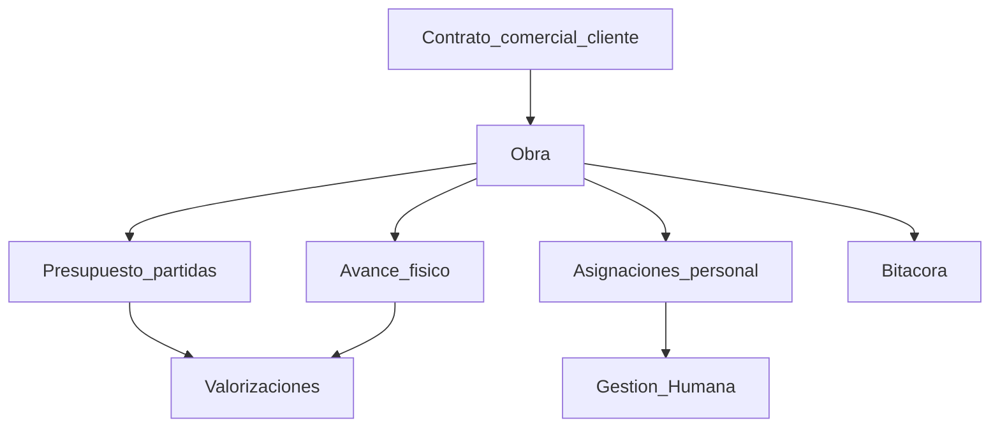

# Obras — fuente de verdad de negocio

Documento estable para humanos y agentes de IA. Define el módulo **Obras** del ERP Convecsa: objetivo, ciclo de vida, procesos, modelo conceptual y reglas de negocio. No sustituye el código; gobierna cómo debe comportarse la implementación.

**Última actualización conceptual:** 2026-10-23  
**Ámbito ERP:** menú Proyectos → Obras (y módulos hijos)

---

## 1. Propósito y alcance

### 1.1 Qué es una Obra

**Obra** (también llamada proyecto de ejecución) es la **unidad de negocio y de control** de la constructora: un trabajo concreto con cliente, alcance, plazos, presupuesto, gente y costos.

Todo lo operativo de Proyectos se cuelga de una Obra:

- Asignaciones de personal
- Presupuesto / partidas
- Avance físico
- Valorizaciones
- Bitácora / diario de obra

### 1.2 Distinciones obligatorias

| Concepto | Qué es | Dónde vive |
|----------|--------|------------|
| **Contrato comercial** | Acuerdo con el **cliente** (o contratista principal): monto, plazos, garantías, forma de pago | Comercial / referencia en Obra |
| **Obra** | Contenedor operativo de la ejecución | Módulo Proyectos → Obras |
| **Contrato laboral** | Vínculo empleador–trabajador (GH) | Gestión Humana → Contratos |
| **Asignación** | Persona (con o sin contrato laboral vigente) destinada a una Obra en un periodo | Proyectos → Asignaciones |

**PROHIBIDO** confundir contrato comercial con contrato laboral.  
**PROHIBIDO** tratar el nombre de proyecto en un contrato laboral como fuente de verdad de la Obra.

### 1.3 Fuera de alcance de este documento (otros módulos)

- SOMA detallado (SST, IPERC, inspecciones) — se asociará a Obra, pero se documenta en SOMA.
- Compras corporativas / proveedores globales.
- Contabilidad general / asientos contables.
- Implementación técnica (SQL, APIs, UI) — solo reglas y procesos.

---

## 2. Objetivo del módulo

1. Ser la **fuente de verdad** de `obra_id` en el ERP.
2. Centralizar identidad, estado, datos contractuales con el cliente y responsables.
3. Permitir que Asignaciones, Avances, Presupuesto, Valorizaciones y Bitácora operen solo sobre obras existentes y en estado válido.
4. Preparar el vínculo futuro con Gestión Humana:
   - Contratos laborales → `obra_id` (dejar de usar solo texto libre `proyecto` / `ubicacion_obra` en metadata).
   - Tareo / nómina / KPIs → destino o contexto de obra cuando aplique.
5. Invertir la dependencia actual: **catálogo Obra → referencias FK**, no al revés.

### 2.1 Mapa de dependencias



---

## 3. Ciclo de vida (estados)

### 3.1 Estados canónicos

| Código | Nombre | Significado |
|--------|--------|-------------|
| `BORRADOR` | Borrador | Alta incompleta; aún no operativa |
| `ADJUDICADA` | Adjudicada | Contrato comercial cerrado o adjudicación confirmada; aún sin ejecución plena |
| `EN_EJECUCION` | En ejecución | Obra activa en campo |
| `PARALIZADA` | Paralizada | Ejecución suspendida temporalmente |
| `EN_LIQUIDACION` | En liquidación | Cierre técnico/administrativo en curso |
| `CERRADA` | Cerrada | Terminada; solo consulta (salvo correcciones excepcionales controladas) |

### 3.2 Transiciones permitidas

```text
BORRADOR        → ADJUDICADA | CERRADA (anulación sin ejecución)
ADJUDICADA      → EN_EJECUCION | CERRADA (desistir antes de ejecutar)
EN_EJECUCION    → PARALIZADA | EN_LIQUIDACION
PARALIZADA      → EN_EJECUCION | EN_LIQUIDACION
EN_LIQUIDACION  → CERRADA | EN_EJECUCION (reapertura excepcional justificada)
CERRADA         → (sin salida normal)
```

**PROHIBIDO** saltar estados (p. ej. `BORRADOR` → `EN_EJECUCION` sin pasar por `ADJUDICADA`, salvo regla explícita futura documentada aquí).  
**PROHIBIDO** eliminar físicamente una obra con movimientos hijos; usar cierre o anulación controlada.

### 3.3 Qué se permite por estado

| Acción | BORRADOR | ADJUDICADA | EN_EJECUCION | PARALIZADA | EN_LIQUIDACION | CERRADA |
|--------|:--------:|:----------:|:------------:|:---------:|:--------------:|:------:|
| Editar identidad básica | Sí | Sí | Sí (limitado) | Sí (limitado) | Limitado | No |
| Editar montos contractuales | Sí | Sí | Solo con justificación / perfil autorizado | No* | No* | No |
| Asignar personal | No | Sí | Sí | Solo consultas / bajas | Solo bajas | No |
| Registrar avance | No | No | Sí | No | Solo ajustes autorizados | No |
| Emitir valorización | No | No | Sí | No | Solo liquidación final | No |
| Bitácora | No | Opcional | Sí | Sí (novedades de paralización) | Sí | No |
| Cargar / editar presupuesto | Sí | Sí | Sí (adicionales controlados) | Limitado | No nuevas partidas | No |

\*Excepto correcciones documentadas por rol autorizado.

---

## 4. Procesos generalizados

Cada proceso define: disparador, actores, entradas, salidas, precondiciones y postcondiciones.

### 4.1 Alta de Obra (inicio de relación contractual)

- **Disparador:** Se firma o adjudica el contrato comercial con el cliente (o se confirma la orden de servicio).
- **Actores:** Comercial / Gerencia de proyectos / Residente designado.
- **Entradas:** Cliente, alcance resumido, ubicación, fechas contractuales, monto (si ya existe), responsable, código o regla de generación de código.
- **Salidas:** Registro Obra en `BORRADOR` o directamente `ADJUDICADA` si el contrato ya está firmado.
- **Precondiciones:** Datos mínimos de identidad y cliente; código único (o generable).
- **Postcondiciones:** Existe `obra_id`. Aún no implica personal ni avance.

**Regla:** SI no hay cliente identificable ENTONCES no se puede pasar de `BORRADOR` a `ADJUDICADA`.

### 4.2 Carga o vinculación de presupuesto

- **Disparador:** Obra adjudicada o en ejecución; se define presupuesto interno o contractual por partidas.
- **Actores:** Oficina técnica / costos / residente.
- **Entradas:** Partidas (código, descripción, unidad, metrado, PU, total), versión de presupuesto.
- **Salidas:** Presupuesto activo vinculado a la Obra.
- **Precondiciones:** Obra en `ADJUDICADA`, `EN_EJECUCION` o `BORRADOR` (borrador solo para estimación).
- **Postcondiciones:** La Obra puede recibir avances valorizables y valorizaciones.

**Regla:** SI se emite una valorización ENTONCES debe existir presupuesto activo (o partida valorizable) en la Obra.

### 4.3 Asignación de personal

- **Disparador:** Necesidad de personal en obra; ingreso o traslado de trabajador.
- **Actores:** RR.HH. / administrador de obra / residente.
- **Entradas:** `obra_id`, persona, rol en obra, fecha inicio (y fin opcional), vínculo opcional a contrato laboral.
- **Salidas:** Asignación activa.
- **Precondiciones:** Obra en estado que permita asignaciones (`ADJUDICADA` o `EN_EJECUCION`); persona existe en GH.
- **Postcondiciones:** La persona queda asociada a la Obra para reportes, tareo futuro y costos.

**Regla:** SI la Obra está `CERRADA` o `BORRADOR` ENTONCES PROHIBIDO crear asignación activa.  
**Regla:** Una persona puede tener historial de varias obras; en un mismo día no debe haber dos asignaciones activas solapadas a obras distintas sin regla de excepción documentada.

### 4.4 Registro de avance físico

- **Disparador:** Corte de control (diario, semanal, mensual) o metrado de partida.
- **Actores:** Supervisión / oficina técnica / residente.
- **Entradas:** Obra, partida o frente, periodo, metrado o % avanzado, evidencias opcionales.
- **Salidas:** Registro de avance acumulable.
- **Precondiciones:** Obra en `EN_EJECUCION`; preferible presupuesto/partidas cargados.
- **Postcondiciones:** Avance disponible para valorización y tableros.

**Regla:** PROHIBIDO registrar avance nuevo en Obra `PARALIZADA` o `CERRADA` (salvo ajuste autorizado en liquidación).

### 4.5 Emisión de valorizaciones

- **Disparador:** Corte contractual de pago / periodo de valorización.
- **Actores:** Oficina técnica / administración / residente.
- **Entradas:** Obra, periodo, avances del corte, presupuesto, retenciones/adelantos según contrato.
- **Salidas:** Valorización (borrador → emitida / presentada).
- **Precondiciones:** Obra en `EN_EJECUCION` (o liquidación final); presupuesto; avances del periodo.
- **Postcondiciones:** Documento de valorización trazable; afecta proyección de ingresos de la obra.

**Regla:** SI no hay presupuesto activo ENTONCES PROHIBIDO emitir valorización.  
**Regla:** Los montos deben respetar moneda de la Obra.

### 4.6 Bitácora / diario de obra

- **Disparador:** Cierre del día o evento relevante (clima, visita, incidente, paralización).
- **Actores:** Residente / asistencia de residencia / supervisión.
- **Entradas:** Fecha, narrativa, tipo de novedad, adjuntos opcionales.
- **Salidas:** Entrada de bitácora.
- **Precondiciones:** Obra no `CERRADA` (y no solo `BORRADOR` vacío).
- **Postcondiciones:** Historial consultable por obra y fecha.

### 4.7 Cierre / liquidación

- **Disparador:** Fin de ejecución física y/o fin de relación contractual administrativa.
- **Actores:** Residente / gerencia / administración.
- **Entradas:** Checklist de entrega, valorización final, liberaciones, dossier.
- **Salidas:** Obra en `EN_LIQUIDACION` y luego `CERRADA`.
- **Precondiciones:** Sin asignaciones activas pendientes de baja (o bajas forzadas documentadas); avances y valorizaciones en estado coherente.
- **Postcondiciones:** Solo lectura operativa; costos e historial permanecen.

**Regla:** SI existen asignaciones activas ENTONCES PROHIBIDO pasar a `CERRADA` sin cerrarlas o documentar excepción.

---

## 5. Modelo conceptual de datos (sin SQL)

### 5.1 Entidad Obra — campos mínimos (alta)

| Grupo | Campos |
|-------|--------|
| Identidad | `codigo` (único), `nombre`, `cliente` (o `cliente_id`), `ubicacion`, `especialidad`/`tipo` (opcional) |
| Contractual | `numero_contrato_cliente` (opcional al alta), `monto_contractual`, `moneda`, `fecha_inicio_contractual`, `fecha_fin_contractual` |
| Gestión | `estado`, `responsable_id` o nombre residente, `fecha_inicio_real`, `fecha_fin_real` (opcionales) |
| Auditoría | `created_at`, `updated_at`, usuario creador (cuando exista) |

### 5.2 Campos extendidos (ficha completa)

- Contratista principal (si CONVECSA es subcontratista)
- Modalidad contractual (suma alzada, precios unitarios, etc.)
- % adelanto, % retención, plazos de pago
- Observaciones / notas
- Ubigeo detallado
- Indicadores calculados (no persistir como verdad única): % avance físico, costo acumulado, margen estimado

### 5.3 Entidades relacionadas (hijos)

| Entidad | Relación con Obra | Notas |
|----------|-------------------|-------|
| Cliente | 1 Obra → 1 Cliente (mínimo) | Catálogo futuro o texto controlado al inicio |
| Contrato comercial | Referencia / N° | Puede modelarse después como entidad propia |
| Presupuesto / Partidas | 1 Obra → N partidas (versionadas) | Base de avance y valorización |
| Asignación | 1 Obra → N asignaciones | Persona + rol + fechas |
| Avance | 1 Obra → N registros | Por partida/frente/periodo |
| Valorización | 1 Obra → N valorizaciones | Cortes de pago |
| Bitácora | 1 Obra → N entradas | Por fecha |
| Frente / área | 1 Obra → N frentes | Opcional fase 1 |

### 5.4 Integración con Gestión Humana

| Origen GH | Uso con Obra |
|-----------|--------------|
| Persona | Destino de asignaciones |
| Contrato laboral | Debe poder referenciar `obra_id` (migración desde metadata texto) |
| Asistencia / tareo | Futuro: filtrar o destinar horas por obra |
| Nómina | Futuro: centro de costo / destino = obra |
| KPIs | Futuro: proyecto = obra del catálogo |

**Regla objetivo:** PROHIBIDO introducir nuevos flujos que guarden solo el nombre de proyecto como texto si ya existe catálogo Obra.

---

## 6. Reglas de negocio estables (para agentes)

Formato imperativo. Los agentes **deben** respetarlas al diseñar o modificar código.

1. **SI** se crea un registro operativo de Proyectos (asignación, avance, valorización, bitácora) **ENTONCES** debe existir `obra_id` válido.
2. **PROHIBIDO** borrar físicamente una Obra que tenga hijos (asignaciones, avances, valorizaciones, bitácora, presupuesto). Usar `CERRADA` o anulación controlada desde `BORRADOR`/`ADJUDICADA` sin movimientos.
3. **El código de Obra es único** en el sistema.
4. **SI** la Obra está `CERRADA` **ENTONCES** PROHIBIDO crear asignaciones activas, avances nuevos o valorizaciones nuevas (salvo proceso de corrección excepcional explícitamente autorizado y auditado).
5. **SI** se emite valorización **ENTONCES** debe existir presupuesto/partida valorizable y moneda coherente con la Obra.
6. **SI** se pasa a `CERRADA` **ENTONCES** no deben quedar asignaciones activas (cerrar o dar de baja antes).
7. **Contrato laboral ≠ contrato comercial.** Los agentes no deben fusionar estas entidades.
8. **Obra es la fuente de verdad** del proyecto de ejecución; metadata textual en contratos laborales es legado a migrar, no el modelo objetivo.
9. **Montos** se expresan en la moneda de la Obra; no mezclar monedas en un mismo documento de valorización sin conversión documentada.
10. **Estados:** solo transiciones de la sección 3.2; no inventar estados en implementación sin actualizar este documento.
11. **Asignaciones** solo en estados que la tabla 3.3 permita.
12. **Avances** solo en `EN_EJECUCION` (ajustes en liquidación solo si están autorizados).
13. **Bitácora** no sustituye avance ni valorización; es registro narrativo/eventos.
14. **Presupuesto versionado:** los cambios que afecten valorizaciones emitidas no deben reescribir historia; usar nuevas versiones o adicionales.
15. Al implementar UI/API, los mensajes de error deben reflejar estas reglas (no silenciosas).

---

## 7. Glosario

| Término | Definición |
|---------|------------|
| **Obra** | Unidad de ejecución y control; entidad maestra de Proyectos |
| **Cliente** | Parte contratante que paga o con quien se firmó el contrato comercial |
| **Contratista principal** | Empresa a la que CONVECSA puede estar subcontratada |
| **Partida** | Ítem de presupuesto (descripción, unidad, metrado, PU, total) |
| **Metrado** | Cantidad física ejecutada o presupuestada de una partida |
| **Avance físico** | Progreso de ejecución medido en metrado o % |
| **Valorización** | Documento de corte que convierte avance en monto a cobrar |
| **Adelanto** | Pago anticipado del cliente, usualmente amortizado en valorizaciones |
| **Retención** | % retenido del cobro como garantía, liberable según contrato |
| **Residente** | Responsable técnico-administrativo de la Obra en campo |
| **Frente** | Subdivisión de la obra (zona o especialidad) para control |
| **Asignación** | Vinculación persona–obra con rol y vigencia |
| **Liquidación** | Proceso de cierre contractual y administrativo de la obra |

---

## 8. Roadmap de implementación en el ERP

Orden de dependencias (no es cronograma de fechas):

| Fase | Qué | Depende de |
|------|-----|------------|
| **1** | Entidad Obra + API + UI listado/alta/edición/estados | — |
| **2** | Asignaciones (persona ↔ obra) | Fase 1 + Personas GH |
| **3a** | Presupuesto / partidas | Fase 1 |
| **3b** | Avances | Fase 1 (+ 3a recomendado) |
| **3c** | Valorizaciones | Fase 1 + 3a + 3b |
| **3d** | Bitácora | Fase 1 |
| **4** | Migrar metadata `proyecto` de contratos laborales a `obra_id` | Fase 1–2 |
| **5** | Tareo / nómina / KPIs por obra | Fases 1–2 |

El menú Proyectos ya contempla: Obras, Asignaciones, Avances, Presupuesto, Valorizaciones, Bitácora.

---

## 9. Instrucciones para agentes de IA

Al trabajar sobre Proyectos / Obras:

1. Leer **este archivo** antes de inventar campos, estados o flujos.
2. Si una regla de negocio debe cambiar, **actualizar este documento en el mismo cambio** que el código.
3. No implementar módulos hijos sin `obra_id`.
4. Preferir nombres de estado y códigos de la sección 3.
5. Mantener separación comercial vs laboral (sección 1.2).
6. Cualquier excepción a las reglas de la sección 6 debe quedar escrita aquí con justificación.

---

*Fin del documento `documentacion/obras.md`.*
